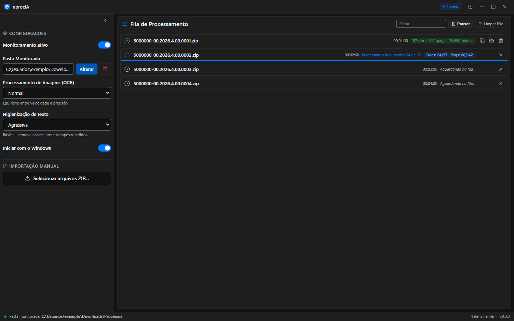
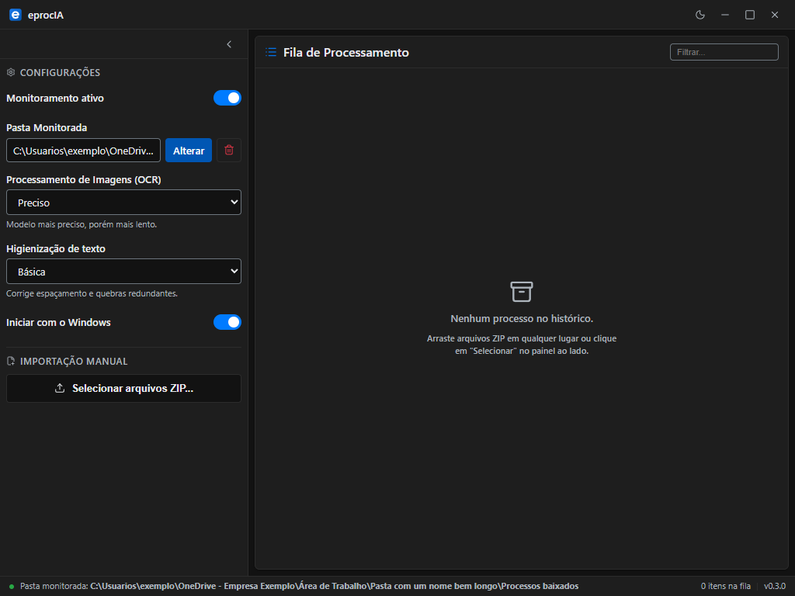
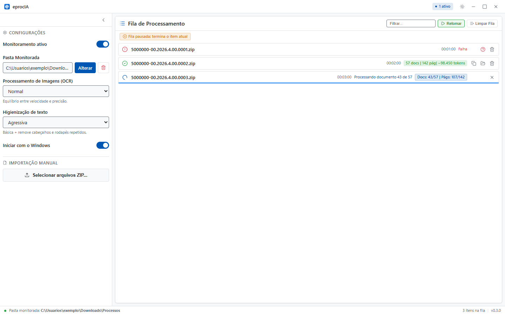
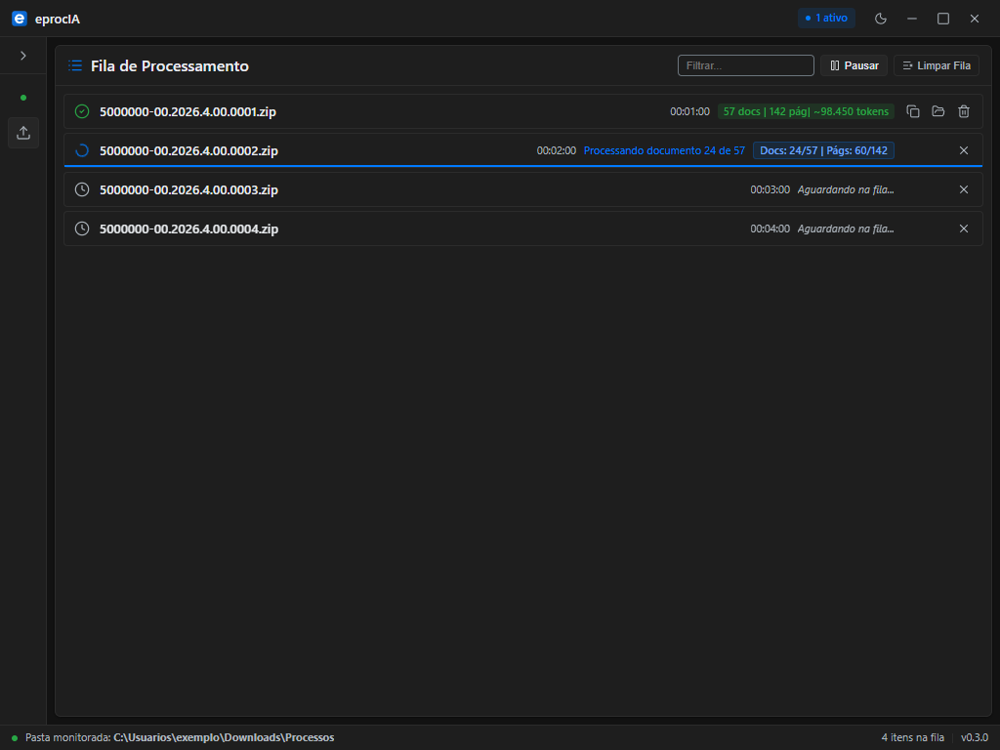
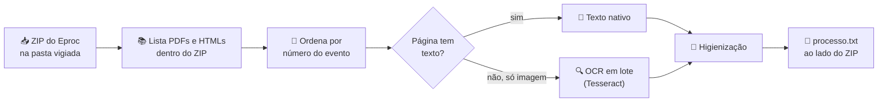

<div align="center">


# eprocIA

**Transforma o ZIP de um processo do Eproc num único texto organizado, pronto para colar numa IA.**

100% offline · OCR embutido · ordem cronológica por evento

[](https://github.com/jonyduque/eprocia/actions/workflows/ci.yml)


[📥 Baixar](https://github.com/jonyduque/eprocia/releases/latest) ·
[✨ Recursos](#-o-que-ele-faz) ·
[📄 Formato da saída](#-formato-da-saída) ·
[🛠️ Desenvolvimento](#️-desenvolvimento)

<br>

<picture>
  <source media="(prefers-color-scheme: dark)" srcset="docs/imagens/tela-escuro.png">
  <source media="(prefers-color-scheme: light)" srcset="docs/imagens/tela-claro.png">
  
</picture>

<sub>Capturas com dados fictícios.</sub>

</div>

---

## 🤔 Para que serve

Quem trabalha com o Eproc baixa o processo como um ZIP cheio de PDFs e HTMLs soltos, com nomes como `Evento 12 - DESPADEC1.pdf`. Para mandar isso a um modelo de linguagem, é preciso abrir cada arquivo, copiar o texto, rodar OCR nas peças escaneadas e manter a ordem dos eventos.

O eprocIA faz tudo isso sozinho. Ele fica na bandeja do Windows, vigia a pasta de downloads e, quando um ZIP do Eproc chega, gera ao lado dele um `.txt` com o processo inteiro, em ordem, marcado com tags que a IA entende.

## ✨ O que ele faz

| | Recurso | Detalhe |
|---|---|---|
| 👀 | **Vigia a pasta** | Detecta ZIPs novos na pasta escolhida e espera o download terminar antes de começar. ZIPs que chegaram com o app fechado são processados ao abrir (janela de 24 h). |
| 📚 | **Lê sem descompactar** | PDFs e HTMLs são lidos direto de dentro do ZIP, sem espalhar arquivos pelo disco. |
| 🔢 | **Ordena por evento** | "Evento 2" vem antes de "Evento 10" (ordenação natural); arquivos sem número de evento vão para o fim. |
| 🔍 | **OCR embutido** | Páginas escaneadas ou desenhadas como vetor passam pelo Tesseract em português, já incluso no executável. O OCR roda em lote, por bloco de páginas. |
| 🧹 | **Higieniza o texto** | Corrige espaços e quebras e, no nível agressivo, remove cabeçalhos e rodapés que se repetem entre as páginas. |
| 🔤 | **Estima tokens** | Cada processo concluído mostra quantos tokens o texto deve ocupar no modelo. |
| 📋 | **Copia com um clique** | O botão de copiar põe o `.txt` inteiro na área de transferência. |
| 🔔 | **Avisa quando termina** | Notificação do Windows quando o processamento acaba com a janela oculta. |
| 🚀 | **Inicia com o Windows** | Sobe oculto na bandeja no logon, já vigiando a pasta. |
| 🌗 | **Tema claro e escuro** | Segue o sistema por padrão; a escolha manual fica gravada. |
| ♿ | **Acessível** | Navegação por teclado, foco visível, anúncios para leitor de tela e respeito à preferência por menos movimento. |

## 🖼️ Telas

<table>
  <tr>
    <td width="50%"></td>
    <td width="50%"></td>
  </tr>
  <tr>
    <td align="center"><sub>⚙️ Configurações, com ajuda para cada opção</sub></td>
    <td align="center"><sub>⏸️ Fila pausada: o item atual termina, os próximos esperam</sub></td>
  </tr>
  <tr>
    <td colspan="2"></td>
  </tr>
  <tr>
    <td colspan="2" align="center"><sub>↔️ Painel recolhido; o divisor também se ajusta pelo teclado e a largura fica lembrada</sub></td>
  </tr>
</table>

## 🔄 Como funciona



- A fila processa **um ZIP por vez**, do mais antigo para o mais novo, e pode ser pausada, retomada ou cancelada.
- Dentro de um ZIP, os documentos são processados **em paralelo**, limitados ao número de núcleos da máquina.
- O OCR só entra quando a página não tem texto nativo suficiente e tem imagens grandes ou texto desenhado como vetor.

## 📄 Formato da saída

O `.txt` sai com o mesmo nome do ZIP e segue o formato do [PRD §6](PRD.md):

```xml
<contexto>
    PROCESSO JUDICIAL - ORDEM CRONOLÓGICA
    Total de Documentos: 57
    Data de Consolidação: 24/10/2026 17:44:02
    Tokens estimados: 98450

    <summary>
    - Evento 1 - INIC1: 3 páginas
    - Evento 1 - PROC2: 1 página
    - Evento 5 - DESPACHO: 1 página
    </summary>
</contexto>

<evento num="1">
    <documento index="1" nome="Evento 1 - INIC1.pdf">
        <pag num="1">
            [texto da petição inicial...]
        </pag>
    </documento>
</evento>
```

> [!TIP]
> As tags `<evento>`, `<documento>` e `<pag>` deixam a IA citar a peça e a página exatas ("Evento 5, despacho, página 1").

## 📥 Instalação

1. Baixe a [última release](https://github.com/jonyduque/eprocia/releases/latest).
2. Escolha o arquivo:
   - 🧩 **`eprocia-X.Y.Z-windows-amd64-instalador.exe`** (recomendado): instala em Arquivos de Programas e mantém "Iniciar com o Windows" funcionando.
   - 📦 **`eprocia-X.Y.Z-windows-amd64.exe`** (portátil): roda de qualquer pasta. Se você movê-lo depois de ligar "Iniciar com o Windows", ligue a opção de novo.
3. Abra o app. Ele já vigia a pasta **Downloads**; se o navegador salva os ZIPs do Eproc em outro lugar, troque em **Pasta Monitorada**.

> [!NOTE]
> O executável não tem assinatura digital, então o SmartScreen pode avisar na primeira execução. Clique em **Mais informações** e depois em **Executar assim mesmo**. Confira o arquivo com o `SHA256SUMS.txt` da release, se quiser.

Requisitos: Windows 10 ou 11 (64 bits) com o WebView2, que já vem no Windows 11.

### 🙋 Instalação só para o seu usuário (script)

[`scripts/instalacao/instalar.ps1`](scripts/instalacao/instalar.ps1) instala sem pedir administrador, em `%LOCALAPPDATA%\Programs\eprocIA`, com atalhos no menu Iniciar e na área de trabalho e entrada em **Aplicativos instalados**. Mesmo num terminal elevado, ele reexecuta a instalação sem privilégios como o usuário dono da sessão, então nada vai para o perfil do administrador.

```powershell
# exe ao lado do script, ou baixa a release mais recente pelo gh (confere o SHA-256)
powershell -ExecutionPolicy Bypass -File instalar.ps1
# outras formas
powershell -ExecutionPolicy Bypass -File instalar.ps1 -Origem .\eprocia.exe -SemAtalhoNaAreaDeTrabalho -NaoAbrir
powershell -ExecutionPolicy Bypass -File instalar.ps1 -Versao v0.3.0
powershell -ExecutionPolicy Bypass -File instalar.ps1 -Desinstalar [-RemoverDados]
```

O `instalar.cmd` faz o mesmo com duplo clique. Para atualizar, rode de novo com o app fechado pela bandeja. Se "Iniciar com o Windows" estiver ligado, ele passa a abrir a cópia instalada.

## ⚙️ Configurações

| Opção | Valores | O que muda |
|---|---|---|
| 🔍 **Processamento de imagens (OCR)** | Desativado · Rápido · **Normal** · Preciso | Modelo do Tesseract usado nas páginas escaneadas. "Desativado" deixa essas páginas sem texto. |
| 🧹 **Higienização de texto** | Nenhuma · **Básica** · Agressiva | Nenhuma preserva o texto bruto; Básica corrige espaçamento e quebras; Agressiva também remove cabeçalhos e rodapés repetidos. |
| 👀 **Monitoramento ativo** | liga/desliga | Vigia ou não a pasta escolhida. Arrastar ZIPs para a janela funciona sempre. |
| 🚀 **Iniciar com o Windows** | liga/desliga | Abre oculto na bandeja no logon. |

As configurações ficam em `%APPDATA%\eprocIA\config.json`.

## 🔒 Privacidade

Nada sai da sua máquina. O eprocIA não faz nenhuma chamada de rede: o OCR, as fontes e a interface vêm embutidos no executável. O texto só vai para uma IA quando **você** cola.

## 🛠️ Desenvolvimento

**Stack:** [Wails v2](https://wails.io) (Go 1.27 no backend, Svelte 5 + Vite no frontend), Tesseract e Poppler embutidos com `go:embed`.

```bash
# Desenvolvimento com hot reload
wails dev

# Testes e verificação
go vet ./...
go test ./... -race
cd frontend && npm run check && npm run build

# Gate completo: vet, test -race, wails build e smoke de 5 s
pwsh scripts/build/gate.ps1

# Release: exe + instalador NSIS (makensis via `scoop install nsis`)
wails build -clean -nsis
```

> [!IMPORTANT]
> O Wails CLI v2.12.0 publicado não funciona com Go 1.27 (`package "bytes" without types was imported`). Recompile-o uma vez com `pwsh scripts/build/recompilar-wails.ps1`.

O CI ([`.github/workflows/ci.yml`](.github/workflows/ci.yml)) roda num runner Windows a cada push ou pull request para `main`: `svelte-check`, build do frontend, testes em Node, `gofmt`, `go vet`, `go test -race` com OCR real e `wails build`.

<details>
<summary>🗂️ <b>Estrutura do código</b></summary>

| Caminho | Papel |
|---|---|
| `main.go`, `app.go` | Janela Wails, bandeja do Windows e métodos expostos ao frontend |
| `internal/etl/` | Fila, pipeline, leitura do ZIP, PDF e HTML, ordenação e formatação da saída |
| `internal/ocr/` | Extração dos binários embutidos e execução do pdftoppm e do Tesseract |
| `internal/watchdog/` | Vigia da pasta (fsnotify) e varredura de ZIPs pendentes ao abrir |
| `internal/config/` | `config.json` com valores padrão e gravação atômica |
| `internal/autostart/` | Chave `Run` do registro para iniciar com o Windows |
| `frontend/src/` | Interface em Svelte 5 |
| `scripts/` | Gate de build, benchmarks, capturas visuais e gerador de ícone |
| `PRD.md`, `DESIGN.md` | Especificação do produto e do visual |

</details>

<details>
<summary>🤖 <b>Harness de revisão com Claude Code</b></summary>

O repositório traz comandos para revisar e corrigir o projeto com agentes:

- `/revisar [backend|frontend|tudo]`: revisão por lentes (eficiência, estabilidade, Go moderno, testes, recursos, visual, animação, layout, acessibilidade, desempenho do frontend), com refutação cética e relatório priorizado em `docs/revisao/`.
- `/corrigir <ids|todos>`: um implementador e um revisor novos por achado, com TDD, gates de build, benchmark e visual, e um commit por id.

Detalhes no [`CLAUDE.md`](CLAUDE.md).

</details>

## 📜 Componentes de terceiros

O executável inclui:

- [Tesseract OCR](https://github.com/tesseract-ocr/tesseract) e os modelos `tessdata` (Apache 2.0)
- [Poppler](https://poppler.freedesktop.org/) `pdftoppm` (GPL)
- [Wails](https://wails.io) (MIT), [Svelte](https://svelte.dev) (MIT), [Lucide](https://lucide.dev) (ISC)

<div align="center">
<br>
<sub>Feito para quem lê processo o dia inteiro ⚖️</sub>
</div>
