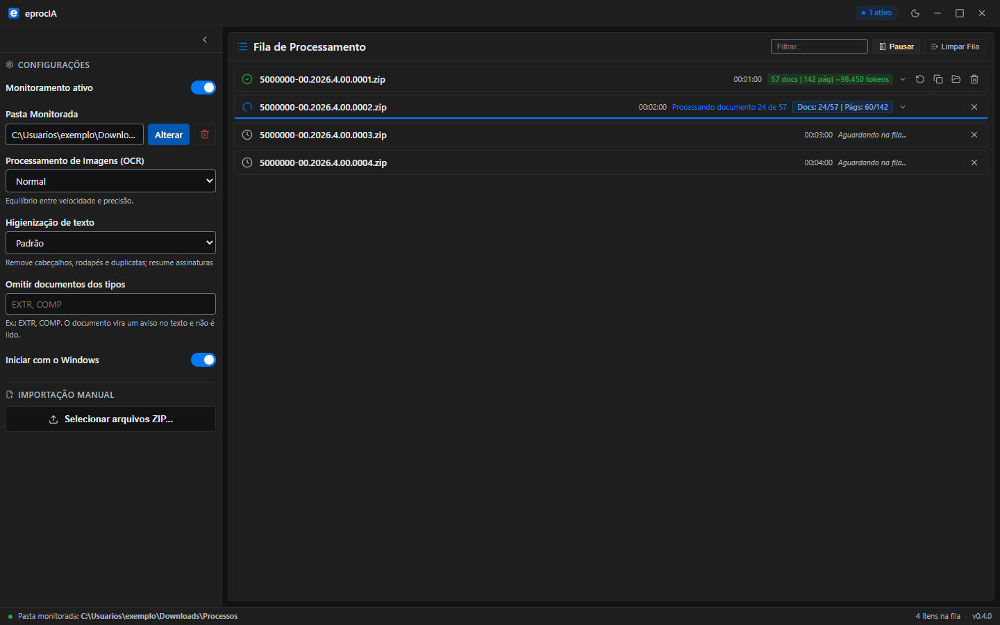
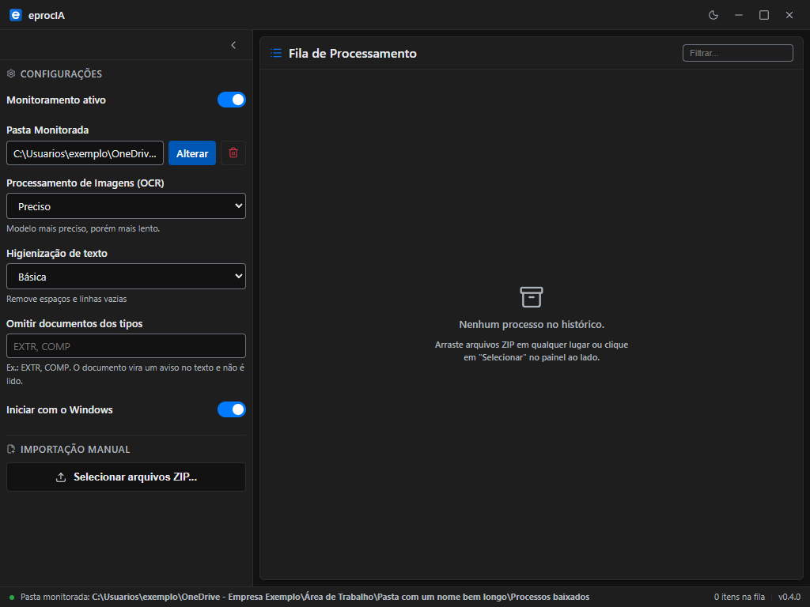
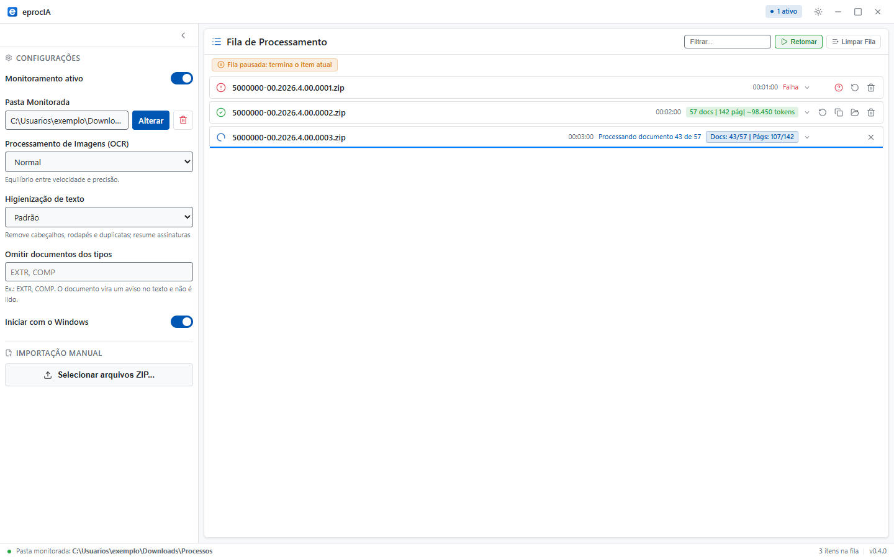
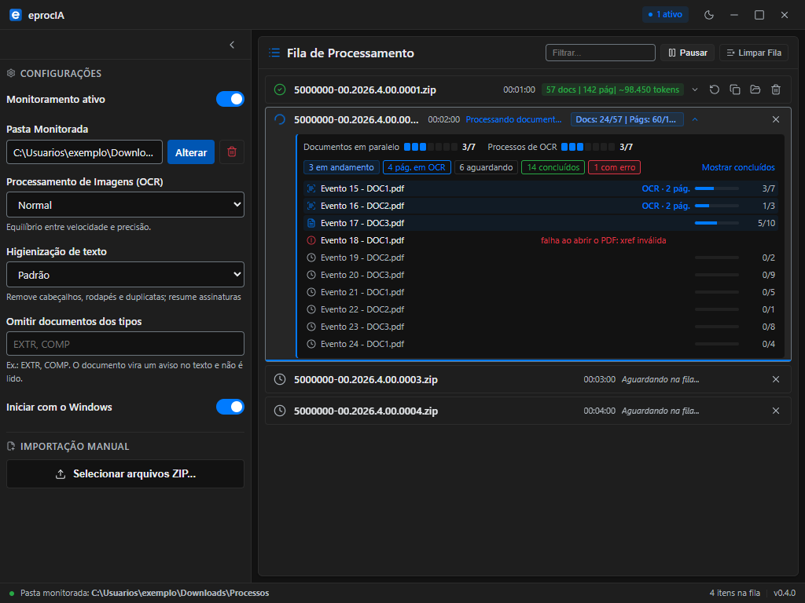
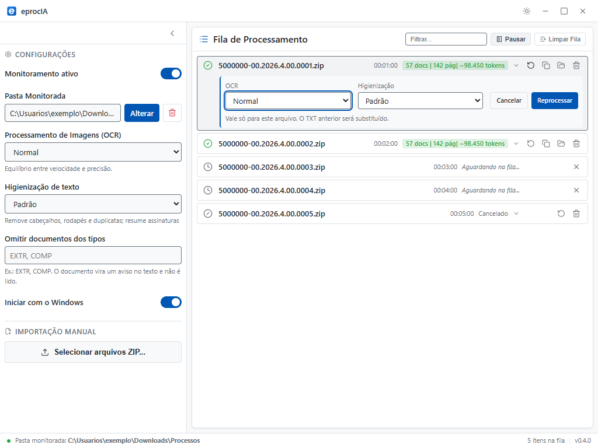
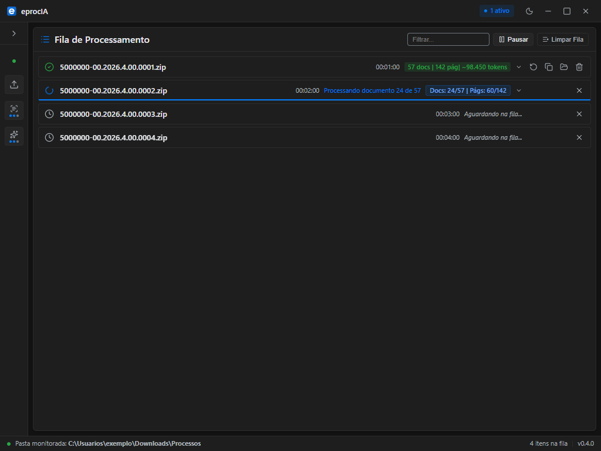
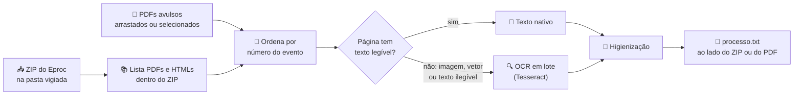

<div align="center">


# eprocIA

**Transforma o ZIP de um processo do Eproc, ou PDFs soltos, num único texto organizado, pronto para colar numa IA.**

Offline (a rede só é usada ao clicar em Procurar atualização) · OCR embutido · ordem cronológica por evento

[](https://github.com/jonyduque/eprocia/actions/workflows/ci.yml)
[](https://github.com/jonyduque/eprocia/releases/latest)
[](LICENSE)


[📥 Baixar](https://github.com/jonyduque/eprocia/releases/latest) ·
[✨ Recursos](#-o-que-ele-faz) ·
[📄 Formato da saída](#-formato-da-saída) ·
[🛠️ Desenvolvimento](#️-desenvolvimento)

<br>

<picture>
  <source media="(prefers-color-scheme: dark)" srcset="docs/imagens/tela-escuro.png">
  <source media="(prefers-color-scheme: light)" srcset="docs/imagens/tela-claro.png">
  
</picture>

<sub>Capturas com dados fictícios.</sub>

</div>

---

## 🤔 Para que serve

Quem trabalha com o Eproc baixa o processo como um ZIP cheio de PDFs e HTMLs soltos, com nomes como `Evento 12 - DESPADEC1.pdf`. Para mandar isso a um modelo de linguagem, é preciso abrir cada arquivo, copiar o texto, rodar OCR nas peças escaneadas e manter a ordem dos eventos.

O eprocIA faz tudo isso sozinho. Ele fica na bandeja do Windows, vigia a pasta de downloads e, quando um ZIP do Eproc chega, gera ao lado dele um `.txt` com o processo inteiro, em ordem, marcado com tags que a IA entende. Uma peça avulsa (a petição inicial, uma sentença, um laudo recebido por e-mail) também entra: arraste ou selecione o PDF, sem precisar zipar.

## ✨ O que ele faz

| | Recurso | Detalhe |
|---|---|---|
| 👀 | **Vigia a pasta** | Detecta ZIPs novos na pasta escolhida e espera o download terminar antes de começar. ZIPs que chegaram com o app fechado são processados ao abrir (janela de 24 h). Com a opção ligada, converte também os PDFs novos da pasta. |
| 📄 | **Aceita PDF avulso** | Arraste ou selecione um ou vários PDFs. Os PDFs soltos juntos viram um TXT só, em ordem de evento, com o número do processo no nome quando todos o trazem. O TXT se chama `processo.txt` ou, se o nome estiver ocupado, `processo_2.txt`, e nunca grava por cima de arquivo alheio; só o reprocessamento do próprio item regrava o TXT que ele gerou. |
| 📚 | **Lê sem descompactar** | PDFs e HTMLs são lidos direto de dentro do ZIP, sem espalhar arquivos pelo disco. O PDF avulso nunca é alterado. |
| 🔢 | **Ordena por evento** | "Evento 2" vem antes de "Evento 10" (ordenação natural); arquivos sem número de evento vão para o fim. |
| 🔍 | **OCR embutido** | Páginas escaneadas, desenhadas como vetor ou com texto nativo ilegível passam pelo Tesseract em português, já incluso no executável. O OCR roda em lote, por bloco de páginas. |
| 🛟 | **Segundo leitor de PDF** | O PDF que a biblioteca de leitura recusa (versão 2.0, envelope de assinatura PKCS#7, cifra AES, tabela de referências inconsistente) é lido pelo Poppler, também embutido. |
| ⚠️ | **Avisa o que não leu** | Documento protegido por senha, ilegível, sem nenhum texto ou digitalizado com o OCR desligado conta como não lido: o item da fila mostra "N não lidos", a notificação e o botão de copiar avisam, e o `.txt` traz a contagem e o motivo. |
| 🧹 | **Higieniza o texto** | Quatro níveis. O Padrão remove cabeçalhos, rodapés e timbres que se repetem, resume as chancelas de assinatura numa linha e troca páginas e documentos repetidos por uma referência ao original. O Máxima também tira ruído de OCR e junta parágrafos quebrados. |
| 🚫 | **Omite tipos de documento** | Informe os códigos (por exemplo `EXTR, COMP`) e esses documentos de um ZIP não são lidos nem passam por OCR: viram um aviso de uma linha no texto. Isso não vale para o PDF avulso, que não é pulado por tipo. |
| 📊 | **Mostra o andamento por documento** | Abra o item em processamento para ver cada documento (aguardando, lendo, em OCR, concluído ou com erro) e quantos processos de OCR estão rodando. |
| 🧾 | **Relata o que leu** | O item concluído diz quantas páginas vieram do texto do PDF, do OCR ou estavam em branco, e avisa as que precisavam de OCR e ficaram sem. Um clique abre os detalhes: tempos, limpeza e os documentos para conferir no PDF original. |
| 🔁 | **Reprocessa com outras opções** | Um item terminado pode ser refeito com outro modo de OCR, outro nível de higienização ou com Forçar OCR, só para aquele arquivo. |
| 🔤 | **Estima tokens** | Cada processo concluído mostra quantos tokens o texto deve ocupar no modelo. |
| 📋 | **Copia com um clique** | O botão de copiar põe o `.txt` inteiro na área de transferência. |
| 🔔 | **Avisa quando termina** | Notificação do Windows quando o processamento acaba com a janela oculta. |
| 🪟 | **Fica na bandeja** | Fechar a janela só a oculta. Duplo clique no ícone da bandeja reabre, e "Sair" no menu encerra. Só uma instância roda por executável: abrir de novo mostra um aviso apontando para o ícone na bandeja. |
| 🚀 | **Inicia com o Windows** | Sobe oculto na bandeja no logon, já vigiando a pasta. |
| 🌗 | **Tema claro e escuro** | Segue o sistema por padrão; a escolha manual fica gravada. |
| ♿ | **Acessível** | Navegação por teclado, foco visível, anúncios para leitor de tela e respeito à preferência por menos movimento. |

## 🖼️ Telas

<table>
  <tr>
    <td width="50%"></td>
    <td width="50%"></td>
  </tr>
  <tr>
    <td align="center"><sub>⚙️ Configurações, com ajuda para cada opção</sub></td>
    <td align="center"><sub>⏸️ Fila pausada: o item atual termina, os próximos esperam</sub></td>
  </tr>
  <tr>
    <td width="50%"></td>
    <td width="50%"></td>
  </tr>
  <tr>
    <td align="center"><sub>📊 Andamento por documento e processos de OCR em paralelo</sub></td>
    <td align="center"><sub>🔁 Reprocessar um item com outras opções, só para aquele arquivo</sub></td>
  </tr>
  <tr>
    <td colspan="2"></td>
  </tr>
  <tr>
    <td colspan="2" align="center"><sub>↔️ Painel recolhido: o círculo liga e desliga o monitoramento, e os atalhos trocam o OCR e a higienização; o divisor também se ajusta pelo teclado e a largura fica lembrada</sub></td>
  </tr>
</table>

## 🔄 Como funciona



- A fila processa **um item por vez** (um ZIP, ou os PDFs soltos de uma vez), do mais antigo para o mais novo, e pode ser pausada, retomada ou cancelada.
- Dentro de um ZIP, os documentos são processados **em paralelo**, limitados ao número de núcleos da máquina.
- O OCR só entra quando a página não tem texto nativo suficiente e tem imagens grandes ou texto desenhado como vetor, ou quando o texto nativo sai ilegível.
- O PDF que a biblioteca de leitura não abre passa pelo Poppler antes de ser dado como não lido.
- Os programas de OCR e de leitura rodam com prazo: um arquivo que trava é marcado e a fila segue.
- Documentos dos tipos que você mandou omitir não são abertos: o tempo de leitura e de OCR deles é poupado. Isso vale só para ZIP: o PDF avulso não é pulado por tipo.

## 📄 Formato da saída

O `.txt` sai com o mesmo nome do ZIP, na mesma pasta, e regrava o TXT anterior desse ZIP. De PDF avulso, sai com o nome do PDF (vários PDFs: o número do processo comum a todos os nomes ou, sem ele, o nome do primeiro na ordem por evento), na pasta do primeiro PDF; se esse nome estiver ocupado, ou se houver um ZIP com o mesmo nome ao lado, vira `processo_2.txt`, `processo_3.txt` e assim por diante, sem gravar por cima de nada. O formato é o do [PRD §6](PRD.md):

```xml
<contexto>
PROCESSO JUDICIAL - ORDEM CRONOLÓGICA
Total de Documentos: 57
Documentos não lidos: 1
Data de Consolidação: 10/11/2026 17:44:02
Tokens estimados: 98450

<summary>
- Evento 1 - INIC1: 3 páginas
- Evento 1 - PROC2: 1 página
- Evento 3 - EXTR1: 12 páginas
- Evento 4 - LAUDO1: NÃO LIDO
</summary>
</contexto>

<evento num="1">
<documento index="1" nome="Evento 1 - INIC1.pdf">
<pag n="1">
[texto da petição inicial...]
</pag>
<pag n="2">
[...]
[assinado: FULANO DE TAL, ADVOGADO, 02/03/2026]
</pag>
</documento>
<documento index="2" nome="Evento 1 - PROC2.pdf">
[texto da procuração, que tem uma página só]
</documento>
</evento>
<evento num="3">
<documento index="3" nome="Evento 3 - EXTR1.pdf">
[documento omitido: EXTR, 12 páginas]
</documento>
</evento>
<evento num="4">
<documento index="4" nome="Evento 4 - LAUDO1.pdf">
[documento não lido: protegido por senha; consulte o PDF original]
</documento>
</evento>
```

- O texto sai sem recuo, para não gastar tokens.
- Documento com uma página só não leva `<pag>`, e página vazia não é escrita.
- A linha `Documentos não lidos:` sai sempre, também com 0. O documento não lido aparece no `<summary>` como `NÃO LIDO` e, no corpo, como `[documento não lido: <motivo>; consulte o PDF original]`.
- Página digitalizada com o OCR desligado sai como `[página digitalizada: o OCR está desativado]`.
- A higienização deixa marcadores no lugar do que tirou: `[assinado: NOME, CARGO, DATA]` para a chancela de assinatura, `[conteúdo idêntico a: evento N, DOCUMENTO, pág. P]` e `[documento idêntico a: evento N, DOCUMENTO]` para repetições, e `[documento omitido: TIPO, N páginas]` para os tipos omitidos.
- Quando alguma página com imagem ou desenho ficou sem texto porque o OCR estava desligado, o cabeçalho ganha a linha `Páginas que precisavam de OCR e ficaram sem: N`, logo depois de `Documentos não lidos:`. Com 0, a linha não sai.
- Uma falha numa página fica escrita no lugar do texto, começando por `[ERRO`, com um motivo curto. O detalhe técnico vai só para o log local, quando ele está ligado (veja [Log e telemetria](#-log-e-telemetria-opcional)).

> [!TIP]
> As tags `<evento>`, `<documento>` e `<pag>` deixam a IA citar a peça e a página exatas ("Evento 5, despacho, página 1").

## ⚠️ Limitações conhecidas

- **PDF protegido por senha não é lido.** Ele conta como não lido, com o motivo dito no item e no `.txt`.
- **O OCR pode errar.** Texto de página digitalizada vem do Tesseract e pode sair com letras trocadas, sobretudo em digitalização ruim ou manuscrito. Se o OCR não acha texto nenhum, o documento conta como não lido ("nenhum texto encontrado").
- **Com o OCR desligado, documento digitalizado não é lido.** Ele sai marcado, e o item oferece "Reprocessar com OCR".
- **`.txt` gerado antes da v0.4.1 pode estar incompleto sem avisar.** Da v0.2.0 à v0.3.0, o PDF que a biblioteca de leitura recusava (cerca de 1 em cada 10, em três processos medidos) ficava de fora do texto e o item aparecia como concluído; documento sem texto nenhum saía como bloco vazio, sem marca. Para conferir um `.txt` antigo, procure por `[ERRO` nele; para refazer, processe o ZIP de novo na versão atual.

Antes de confiar numa análise, veja a linha `Documentos não lidos:` no começo do `.txt` ou o aviso "N não lidos" no item da fila.

## 📥 Instalação

1. Baixe a [última release](https://github.com/jonyduque/eprocia/releases/latest).
2. Escolha o arquivo:
   - 🧩 **`eprocia-X.Y.Z-windows-amd64-instalador.exe`** (recomendado): instala em Arquivos de Programas e mantém "Iniciar com o Windows" funcionando.
   - 📦 **`eprocia-X.Y.Z-windows-amd64.exe`** (portátil): roda de qualquer pasta. Se você movê-lo depois de ligar "Iniciar com o Windows", ligue a opção de novo.
3. Abra o app. Ele já vigia a pasta **Downloads**; se o navegador salva os ZIPs do Eproc em outro lugar, troque em **Alterar**, abaixo de **Monitorar a pasta** nas Configurações. Para um PDF solto, arraste-o para a janela ou use **Selecionar arquivos...**, na fila vazia.

> [!NOTE]
> O executável não tem assinatura digital, então o SmartScreen pode avisar na primeira execução. Clique em **Mais informações** e depois em **Executar assim mesmo**. Confira o arquivo com o `SHA256SUMS.txt` da release, se quiser.

> [!NOTE]
> As releases posteriores à v0.3.0 são compiladas pelo GitHub Actions a partir da tag e levam uma atestação de procedência, que liga cada arquivo ao commit e ao workflow que o gerou. Veja como conferir no [`SECURITY.md`](SECURITY.md).

Requisitos: Windows 10 ou 11 (64 bits) com o WebView2, que já vem no Windows 11.

### ⚡ Instalação por linha de comando (só para o seu usuário)

No PowerShell:

```powershell
irm https://raw.githubusercontent.com/jonyduque/eprocia/main/install.ps1 | iex
```

O [`install.ps1`](install.ps1) baixa a release mais recente, confere o SHA-256 com o `SHA256SUMS.txt` e instala em `%LOCALAPPDATA%\Programs\eprocIA`, com atalhos no menu Iniciar e na área de trabalho e entrada em **Aplicativos instalados**. Rodar de novo atualiza no lugar a versão já instalada: a por usuário ou, se só houver ela, a instalação para todos os usuários (feita pelo instalador). Com o eprocIA aberto, ele pergunta antes de fechá-lo e só o fecha na hora de trocar o arquivo, depois do download. Só pede administrador (UAC) para atualizar ou remover a instalação para todos os usuários; a instalação por usuário nunca pede. Num terminal elevado, ele pergunta antes de rodar de novo, sem privilégios, como o dono da sessão do Windows, então nada vai para o perfil do administrador. `-Yes` pula as perguntas (inclusive a de fechar o app aberto).

Com opções:

```powershell
& ([scriptblock]::Create((irm https://raw.githubusercontent.com/jonyduque/eprocia/main/install.ps1))) -DryRun
```

| Opção | O que faz |
|---|---|
| `-Version v0.3.0` | Instala essa release em vez da mais recente. |
| `-Dir <pasta>` | Instala em outra pasta. |
| `-From <eprocia.exe>` | Instala um exe local, sem baixar. |
| `-NoDesktop` | Sem atalho na área de trabalho. |
| `-NoStart` | Não abre o app ao terminar. |
| `-DryRun` | Mostra o que faria e pergunta se deve fazer. |
| `-Uninstall` | Remove app, atalhos e entrada de desinstalação; mantém as configurações. |
| `-Uninstall -Purge` | Remove também configurações, histórico da fila, dados do WebView2 e cache do OCR. |

## ⚙️ Configurações

| Opção | Valores | O que muda |
|---|---|---|
| 🔍 **Processamento de imagens (OCR)** | Desativado · Rápido · **Normal** · Preciso | Modelo do Tesseract usado nas páginas escaneadas. "Desativado" deixa essas páginas sem texto. |
| 🔎 **Forçar OCR** | liga/desliga (**desligado**) | Toda página de PDF passa pelo OCR, inclusive as que já têm texto. Veja abaixo. |
| 🧹 **Higienização de texto** | Nenhuma · Básica · **Padrão** · Máxima | Nenhuma preserva o texto como extraído; Básica remove espaços e linhas vazias; Padrão também remove cabeçalhos, rodapés e duplicatas e resume assinaturas; Máxima acrescenta a limpeza de ruído de OCR e junta parágrafos. |
| 🚫 **Omitir documentos dos tipos** | códigos separados por vírgula (ex.: `EXTR, COMP`) | O documento desses tipos vira um aviso no texto e não é lido. |
| 👀 **Monitoramento ativo** | liga/desliga | Vigia ou não a pasta escolhida. Arrastar ZIPs ou PDFs para a janela funciona sempre. |
| 📄 **Também converter PDFs novos nesta pasta** | liga/desliga (**desligado**) | A pasta monitorada passa a converter cada PDF que aparecer nela, inclusive boletos e outros PDFs que não são de processo, num TXT ao lado. Ao ligar a opção e a cada abertura do eprocIA, a varredura da pasta também converte os PDFs das últimas 24 h que ainda não têm TXT. Um PDF que já tem TXT mais novo não é convertido de novo. |
| 🚀 **Iniciar com o Windows** | liga/desliga | Abre oculto na bandeja no logon. |
| 🕘 **Guardar a lista da última sessão** | liga/desliga (**desligado**) | Ao reabrir, a fila mostra os processos da última sessão em que algo foi processado (até 500), com data e hora na linha e as ações de antes. O que estava processando ou aguardando ao fechar aparece como **Interrompido**, com **Processar de novo**; com o monitoramento ligado, um ZIP das últimas 24 h sem TXT volta a processar sozinho na mesma linha. Se o TXT sumiu, a linha diz **TXT não encontrado**. Veja [Privacidade](#-privacidade). |

As configurações ficam em `%APPDATA%\eprocIA\config.json`.

### 🧾 Relatório e Forçar OCR

- O item concluído mostra uma linha-resumo ("142 páginas: 120 do texto do PDF, 18 por OCR, 4 em branco") e, em âmbar, só o que pede atenção: páginas que precisavam de OCR e ficaram sem, páginas que não puderam ser lidas, páginas em que o OCR falhou e ficou o texto do PDF, documentos digitalizados não lidos com o OCR desligado. Página em branco ou só com texto não vai ao OCR, e isso é normal.
- Clicar na linha-resumo abre os detalhes: páginas por categoria, tempo total e de OCR, a redução da higienização, os tipos omitidos e os documentos para conferir no PDF original, com os números das páginas.
- Quando faltou OCR, o botão **Ler com OCR** refaz o ZIP com o OCR ligado (o modo das Configurações, ou Normal se ele estiver desligado), só nas páginas que precisam e com a mesma higienização. As Configurações não mudam.
- **Forçar OCR** manda ao OCR toda página de PDF, mesmo com texto (HTML não passa). Existe nas Configurações (vale para todo ZIP) e no Reprocessar (vale só para aquele arquivo). Não tem efeito com o OCR desligado. É bem mais lento, e numa página com texto bom o resultado pode sair um pouco pior; mas, quando o OCR falha, sai em branco ou ilegível numa página que só foi a ele por Forçar OCR, fica o texto do PDF, como sem forçar.

## 🔄 Atualização pelo programa

O eprocIA **não procura atualização sozinho**: nem ao abrir, nem de tempos em tempos. Só quando você clica em **Procurar atualização**, no bloco Atualizações das Configurações, ele consulta a última versão publicada em `jonyduque/eprocia` no GitHub. O GitHub vê o IP da máquina, a hora e o `User-Agent` `eprocIA/<versão>`; nenhum nome de arquivo, caminho ou conteúdo sai (PRD, RNF06). Não há telemetria.

- **Instalação por usuário** (a do `install.ps1`): "Atualizar" baixa, confere o SHA-256 e instala a versão nova com o programa aberto; ela passa a valer ao reiniciar, pelo botão **Reiniciar agora** ou na próxima abertura. O programa não guarda a versão anterior: para voltar, use `install.ps1 -Version`.
- **Instalação pelo instalador (NSIS):** "Baixar e abrir o instalador" baixa, confere e abre o instalador, que pede permissão de administrador e fecha o programa.
- Em qualquer outro local do executável, o programa só avisa que há versão nova.

## 📝 Log e telemetria (opcional)

Desligados por padrão: sem a variável de ambiente `EPROCIA_LOG`, o app não grava log nem telemetria e as Configurações não mostram nada sobre eles.

| `EPROCIA_LOG` | Efeito |
|---|---|
| ausente ou vazia | Nada é gravado. |
| `1` | Log (eventos de ZIP e de documento, avisos e erros) e telemetria. |
| `detalhado` | O mesmo, mais uma linha por página (nível Debug). |

Um valor diferente vale como `1`, com um aviso no log. A variável é lida só na partida do app.

**Para ligar**, crie a variável de usuário em **Editar as variáveis de ambiente para sua conta** (procure "variáveis de ambiente" no menu Iniciar) ou, num terminal:

```powershell
setx EPROCIA_LOG 1          # ou: setx EPROCIA_LOG detalhado
```

A variável só chega a processos novos. Saia pela bandeja (**Sair**; fechar a janela só oculta) e abra de novo pelo atalho ou pelo menu Iniciar. Um terminal ou programa que já estava aberto, inclusive aquele em que se roda o `install.ps1`, não recebe a variável: abra um novo.

**Para desligar**, apague a variável nas Variáveis de Ambiente ou rode `[Environment]::SetEnvironmentVariable('EPROCIA_LOG', $null, 'User')` no PowerShell, e reabra o app do mesmo jeito.

Com o log ligado, as Configurações mostram **Abrir pasta de logs**. Os arquivos ficam só neste computador:

| Arquivo | Conteúdo | Rotação |
|---|---|---|
| `%APPDATA%\eprocIA\logs\eprocia.log` | JSON Lines. Leva os **nomes dos ZIPs e dos documentos** (o nome do ZIP costuma ser o número do processo). Nos caminhos, o perfil e a pasta temporária viram `%USERPROFILE%` e `%TEMP%`, e outro nome depois de `\Users\` vira `<usuario>`. | 5 MB, guarda `eprocia.1.log` a `eprocia.5.log`; `eprocia*.log` com mais de 30 dias é apagado quando o app abre com o log ligado. |
| `%APPDATA%\eprocIA\telemetria\telemetria.jsonl` | Uma linha por ZIP terminado: contagens de páginas e documentos, tamanhos, tempos, a configuração usada (sem a pasta) e o resultado. Da máquina, só número de núcleos, memória total, versão e build do Windows e arquitetura. **Nenhum nome** de ZIP, documento, pasta, computador ou usuário, e nenhum texto de página. | 10 MB, guarda 5 arquivos; não apaga por idade. |

Nada disso é enviado: log e telemetria não usam a rede. Para partilhar, prefira **só a telemetria**. O log e a telemetria têm o mesmo `item_id`, então quem recebe os dois consegue ligar a telemetria aos nomes.

Para partilhar um log sem os nomes, passe-o pelo `scripts/anonimizar-log` (precisa do Go e deste repositório):

```bash
go run ./scripts/anonimizar-log eprocia.log eprocia.1.log
```

- Troca cada nome de ZIP por `zip-N` e cada nome de documento por `doc-N`. Vários arquivos numa mesma execução partilham a tabela, então o mesmo nome tem o mesmo rótulo em todos.
- Grava `<nome>.anon.log` ao lado de cada entrada e lista as linhas em que ainda sobrou caminho com nome de usuário (sai com código 1 nesse caso).
- Copie os arquivos para fora da pasta de logs antes de rodar: um `eprocia.anon.log` gravado lá dentro casa com `eprocia*.log` e é apagado pela limpeza de 30 dias.
- O nome do ZIP sem a extensão também é trocado onde aparece sozinho (delimitado), mas só com 4 caracteres ou mais; um nome mais curto só é trocado nas formas com extensão (`.zip`, `.txt`).
- Números de processo que aparecem fora dos nomes de ZIP e de documento ficam como estão. Leia o arquivo antes de partilhar.

## 🔒 Privacidade

Nada sai da sua máquina. O eprocIA só usa a rede quando você clica em "Procurar atualização" (veja acima); fora isso, não faz nenhuma chamada: o OCR, as fontes e a interface vêm embutidos no executável. O texto só vai para uma IA quando **você** cola. O log e a telemetria, quando ligados por `EPROCIA_LOG`, ficam só no computador.

Com **Guardar a lista da última sessão** ligado (vem desligado), o eprocIA grava em `%APPDATA%\eprocIA\historico.json` os nomes dos arquivos da fila (no Eproc, números de processo) e as pastas deles, que trazem o nome do seu usuário do Windows; nenhum texto de documento. Fica só a última sessão com processamento, até 500 itens, e o arquivo nunca sai da máquina. Em computador compartilhado com o mesmo login, outra pessoa vê esses processos ao abrir o programa. Para limpar: o **X** da linha apaga o item, **Limpar tudo** apaga a lista inteira, desligar a opção apaga o arquivo, e `install.ps1 -Uninstall -Purge` apaga todos os dados do eprocIA.

## 🛠️ Desenvolvimento

**Stack:** [Wails v2](https://wails.io) (Go 1.27 no backend, Svelte 5 + Vite no frontend), Tesseract e Poppler embutidos com `go:embed`.

```bash
# Desenvolvimento com hot reload
wails dev

# Testes e verificação
go vet ./...
go test ./... -race
cd frontend && npm run check && npm run build
node --test frontend/*.test.mjs

# Gate completo: vet, test -race, wails build e smoke de 5 s
pwsh scripts/build/gate.ps1

# Release: exe + instalador NSIS (makensis via `scoop install nsis`)
wails build -clean -nsis
```

> [!IMPORTANT]
> O Wails CLI publicado (v2.12.0 e v2.13.0) não funciona com Go 1.27 (`package "bytes" without types was imported`). Recompile-o uma vez com `pwsh scripts/build/recompilar-wails.ps1`.

Três workflows rodam no GitHub Actions:

- [`ci.yml`](.github/workflows/ci.yml), num runner Windows a cada push ou pull request para `main`: `svelte-check`, build do frontend, testes em Node, `gofmt`, `go vet`, `go test -race` com OCR real e `wails build`.
- [`security.yml`](.github/workflows/security.yml), a cada push e toda semana: osv-scanner nos lockfiles e govulncheck. As exceções ficam em [`osv-scanner.toml`](osv-scanner.toml), cada uma com motivo e validade.
- [`release.yml`](.github/workflows/release.yml), a partir de uma tag `v*`: compila o exe e o instalador, gera o `SHA256SUMS.txt` e a atestação de procedência e deixa a release como rascunho para revisão. As tags `v*` são imutáveis.

Para relatar uma vulnerabilidade, siga o [`SECURITY.md`](SECURITY.md).

<details>
<summary>🗂️ <b>Estrutura do código</b></summary>

| Caminho | Papel |
|---|---|
| `main.go`, `app.go` | Janela Wails e métodos expostos ao frontend |
| `bandeja.go`, `instancia*.go` | Ícone e menu da bandeja; trava de instância única por executável |
| `internal/etl/` | Fila, pipeline, leitura do ZIP, PDF e HTML, ordenação, higienização e formatação da saída |
| `internal/models/` | Tipos compartilhados entre os pacotes |
| `internal/janela/` | Animação de ocultar e mostrar a janela |
| `internal/ocr/` | Extração dos binários embutidos e execução do pdftoppm e do Tesseract |
| `internal/saida/` | Regra única do nome do TXT de saída e gravação sem sobrescrever |
| `internal/watchdog/` | Vigia da pasta (fsnotify) e varredura de ZIPs (e, com a opção, PDFs) pendentes ao abrir |
| `internal/config/` | `config.json` com valores padrão e gravação atômica |
| `internal/autostart/` | Chave `Run` do registro para iniciar com o Windows |
| `internal/registro/` | Log em arquivo com `EPROCIA_LOG`: rotação, retenção e troca do nome do usuário |
| `internal/telemetria/` | Registro local por ZIP, sem nomes |
| `frontend/src/` | Interface em Svelte 5 |
| `scripts/` | Gate de build, benchmarks, capturas visuais, gerador de ícone e `anonimizar-log` |
| `.github/workflows/` | CI, varredura de segurança e release |
| `PRD.md`, `DESIGN.md` | Especificação do produto e do visual |

</details>

<details>
<summary>🤖 <b>Harness de revisão com Claude Code</b></summary>

O repositório traz comandos para revisar e corrigir o projeto com agentes:

- `/revisar [backend|frontend|tudo]`: revisão por lentes (eficiência, estabilidade, Go moderno, testes, recursos, visual, animação, layout, acessibilidade, desempenho do frontend), com refutação cética e relatório priorizado em `docs/revisao/`.
- `/corrigir <ids|todos>`: um implementador e um revisor novos por achado, com TDD, gates de build, benchmark e visual, e um commit por id.

Detalhes no [`CLAUDE.md`](CLAUDE.md).

</details>

## 📜 Licença

O eprocIA é software livre sob a [GNU General Public License v3.0](LICENSE): você pode usar, estudar, modificar e redistribuir, desde que as versões distribuídas mantenham a mesma licença e o código-fonte disponível.

### Componentes de terceiros

O executável inclui:

- [Tesseract OCR](https://github.com/tesseract-ocr/tesseract) 5.5.0 e os modelos `tessdata` (Apache 2.0)
- [Poppler](https://poppler.freedesktop.org/) 25.07.0 `pdftoppm`, `pdfinfo`, `pdftotext` e suas DLLs (GPL; código-fonte em [poppler-25.07.0.tar.xz](https://poppler.freedesktop.org/poppler-25.07.0.tar.xz))
- [Wails](https://wails.io) (MIT), [Svelte](https://svelte.dev) (MIT), [Lucide](https://lucide.dev) (ISC)
- [energye/systray](https://github.com/energye/systray) (Apache 2.0), [dslipak/pdf](https://github.com/dslipak/pdf) e [fsnotify](https://github.com/fsnotify/fsnotify) (BSD de 3 cláusulas)

<div align="center">
<br>
<sub>Feito para quem lê processo o dia inteiro ⚖️</sub>
</div>
