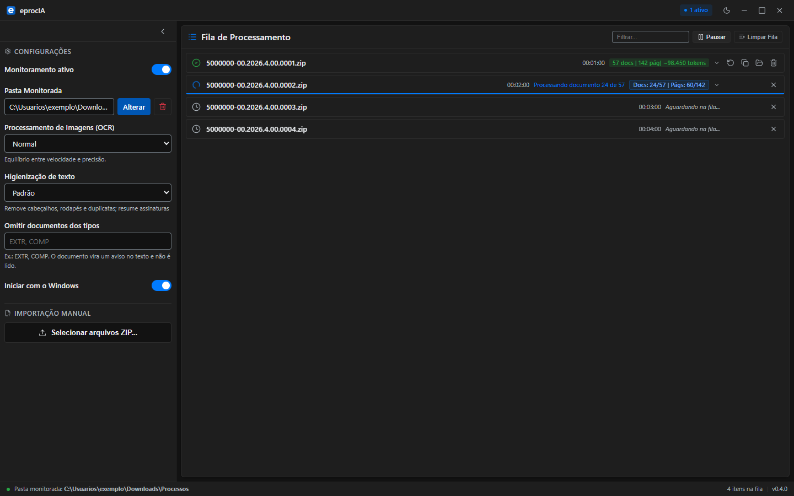
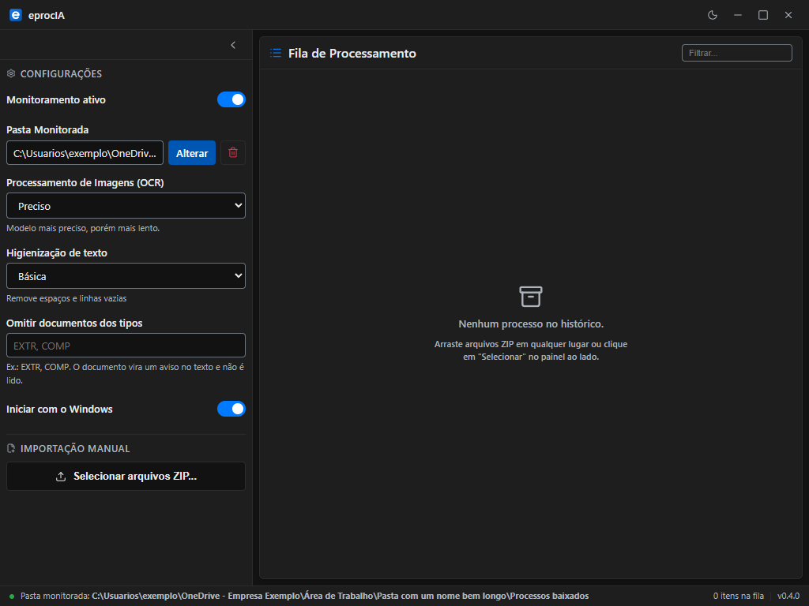
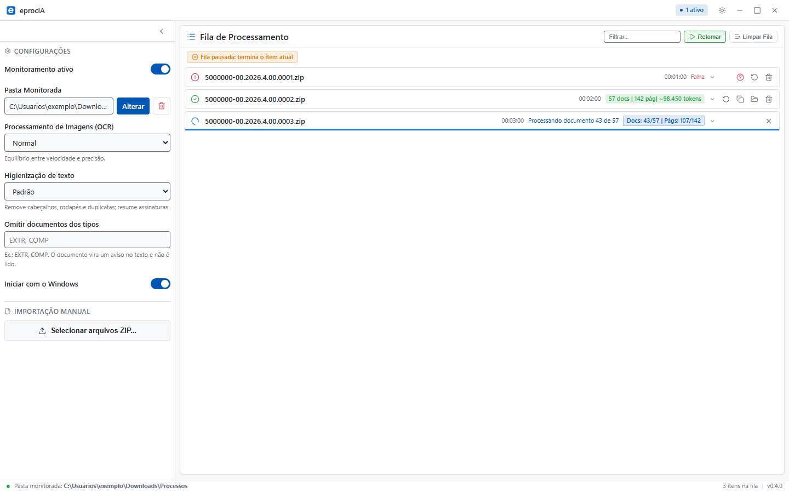
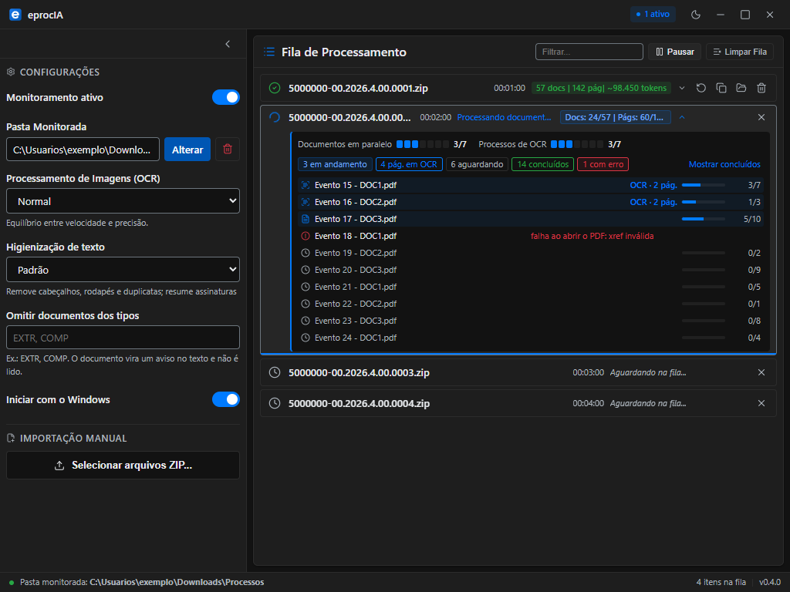
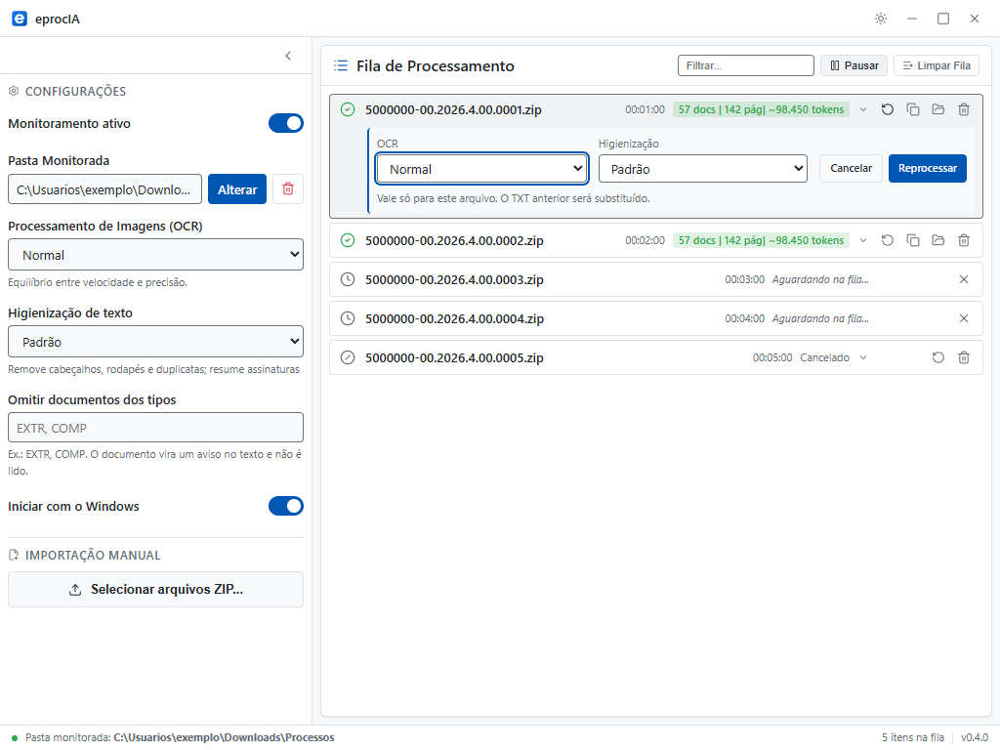
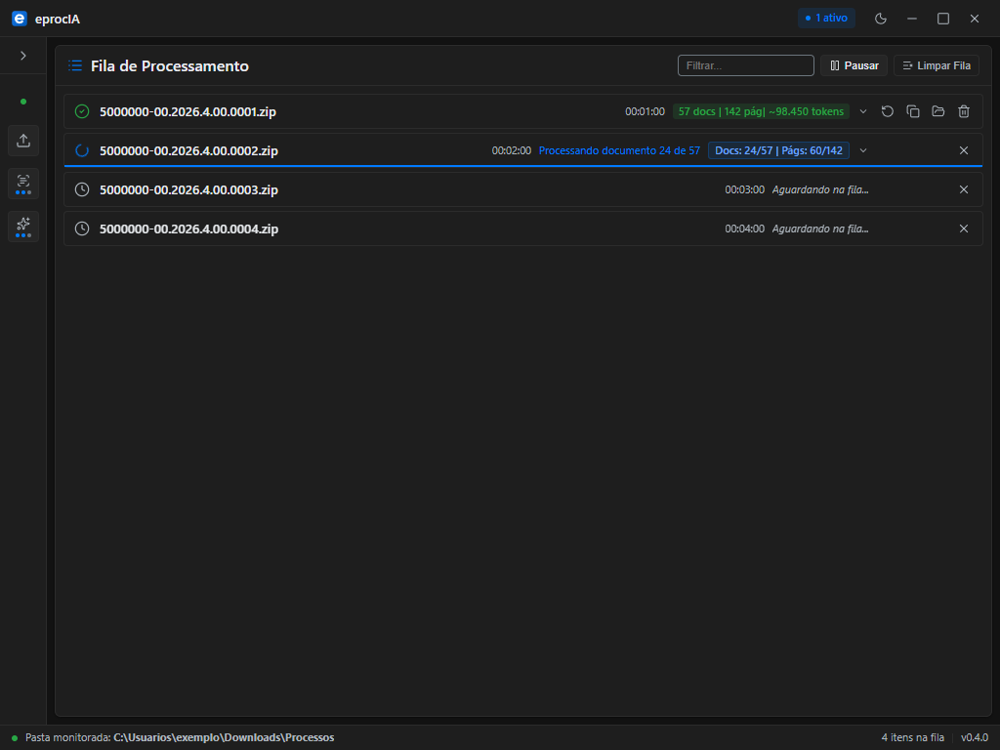
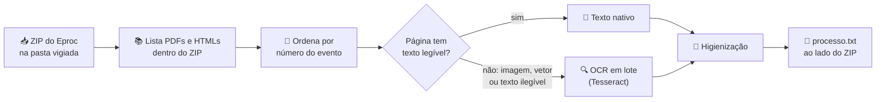

<div align="center">


# eprocIA

**Transforma o ZIP de um processo do Eproc num único texto organizado, pronto para colar numa IA.**

100% offline · OCR embutido · ordem cronológica por evento

[](https://github.com/jonyduque/eprocia/actions/workflows/ci.yml)
[](https://github.com/jonyduque/eprocia/releases/latest)
[](LICENSE)


[📥 Baixar](https://github.com/jonyduque/eprocia/releases/latest) ·
[✨ Recursos](#-o-que-ele-faz) ·
[📄 Formato da saída](#-formato-da-saída) ·
[🛠️ Desenvolvimento](#️-desenvolvimento)

<br>

<picture>
  <source media="(prefers-color-scheme: dark)" srcset="docs/imagens/tela-escuro.png">
  <source media="(prefers-color-scheme: light)" srcset="docs/imagens/tela-claro.png">
  
</picture>

<sub>Capturas com dados fictícios.</sub>

</div>

---

## 🤔 Para que serve

Quem trabalha com o Eproc baixa o processo como um ZIP cheio de PDFs e HTMLs soltos, com nomes como `Evento 12 - DESPADEC1.pdf`. Para mandar isso a um modelo de linguagem, é preciso abrir cada arquivo, copiar o texto, rodar OCR nas peças escaneadas e manter a ordem dos eventos.

O eprocIA faz tudo isso sozinho. Ele fica na bandeja do Windows, vigia a pasta de downloads e, quando um ZIP do Eproc chega, gera ao lado dele um `.txt` com o processo inteiro, em ordem, marcado com tags que a IA entende.

## ✨ O que ele faz

| | Recurso | Detalhe |
|---|---|---|
| 👀 | **Vigia a pasta** | Detecta ZIPs novos na pasta escolhida e espera o download terminar antes de começar. ZIPs que chegaram com o app fechado são processados ao abrir (janela de 24 h). |
| 📚 | **Lê sem descompactar** | PDFs e HTMLs são lidos direto de dentro do ZIP, sem espalhar arquivos pelo disco. |
| 🔢 | **Ordena por evento** | "Evento 2" vem antes de "Evento 10" (ordenação natural); arquivos sem número de evento vão para o fim. |
| 🔍 | **OCR embutido** | Páginas escaneadas, desenhadas como vetor ou com texto nativo ilegível passam pelo Tesseract em português, já incluso no executável. O OCR roda em lote, por bloco de páginas. |
| 🧹 | **Higieniza o texto** | Quatro níveis. O Padrão remove cabeçalhos, rodapés e timbres que se repetem, resume as chancelas de assinatura numa linha e troca páginas e documentos repetidos por uma referência ao original. O Máxima também tira ruído de OCR e junta parágrafos quebrados. |
| 🚫 | **Omite tipos de documento** | Informe os códigos (por exemplo `EXTR, COMP`) e esses documentos não são lidos nem passam por OCR: viram um aviso de uma linha no texto. |
| 📊 | **Mostra o andamento por documento** | Abra o item em processamento para ver cada documento (aguardando, lendo, em OCR, concluído ou com erro) e quantos processos de OCR estão rodando. |
| 🔁 | **Reprocessa com outras opções** | Um item terminado pode ser refeito com outro modo de OCR ou outro nível de higienização, só para aquele arquivo. |
| 🔤 | **Estima tokens** | Cada processo concluído mostra quantos tokens o texto deve ocupar no modelo. |
| 📋 | **Copia com um clique** | O botão de copiar põe o `.txt` inteiro na área de transferência. |
| 🔔 | **Avisa quando termina** | Notificação do Windows quando o processamento acaba com a janela oculta. |
| 🪟 | **Fica na bandeja** | Fechar a janela só a oculta. Duplo clique no ícone da bandeja reabre, e "Sair" no menu encerra. Só uma instância roda por executável: abrir de novo mostra um aviso apontando para o ícone na bandeja. |
| 🚀 | **Inicia com o Windows** | Sobe oculto na bandeja no logon, já vigiando a pasta. |
| 🌗 | **Tema claro e escuro** | Segue o sistema por padrão; a escolha manual fica gravada. |
| ♿ | **Acessível** | Navegação por teclado, foco visível, anúncios para leitor de tela e respeito à preferência por menos movimento. |

> [!NOTE]
> Este README descreve o código da branch `main`. A versão publicada (v0.3.0) ainda não tem os níveis Padrão e Máxima de higienização, a omissão por tipo, o andamento por documento, o reprocessamento, o duplo clique na bandeja nem a instância única. Eles chegam na próxima release.

## 🖼️ Telas

<table>
  <tr>
    <td width="50%"></td>
    <td width="50%"></td>
  </tr>
  <tr>
    <td align="center"><sub>⚙️ Configurações, com ajuda para cada opção</sub></td>
    <td align="center"><sub>⏸️ Fila pausada: o item atual termina, os próximos esperam</sub></td>
  </tr>
  <tr>
    <td width="50%"></td>
    <td width="50%"></td>
  </tr>
  <tr>
    <td align="center"><sub>📊 Andamento por documento e processos de OCR em paralelo</sub></td>
    <td align="center"><sub>🔁 Reprocessar um item com outras opções, só para aquele arquivo</sub></td>
  </tr>
  <tr>
    <td colspan="2"></td>
  </tr>
  <tr>
    <td colspan="2" align="center"><sub>↔️ Painel recolhido: o círculo liga e desliga o monitoramento, e os atalhos trocam o OCR e a higienização; o divisor também se ajusta pelo teclado e a largura fica lembrada</sub></td>
  </tr>
</table>

## 🔄 Como funciona



- A fila processa **um ZIP por vez**, do mais antigo para o mais novo, e pode ser pausada, retomada ou cancelada.
- Dentro de um ZIP, os documentos são processados **em paralelo**, limitados ao número de núcleos da máquina.
- O OCR só entra quando a página não tem texto nativo suficiente e tem imagens grandes ou texto desenhado como vetor, ou quando o texto nativo sai ilegível.
- Documentos dos tipos que você mandou omitir não são abertos: o tempo de leitura e de OCR deles é poupado.

## 📄 Formato da saída

O `.txt` sai com o mesmo nome do ZIP e segue o formato do [PRD §6](PRD.md):

```xml
<contexto>
PROCESSO JUDICIAL - ORDEM CRONOLÓGICA
Total de Documentos: 57
Data de Consolidação: 10/11/2026 17:44:02
Tokens estimados: 98450

<summary>
- Evento 1 - INIC1: 3 páginas
- Evento 1 - PROC2: 1 página
- Evento 3 - EXTR1: 12 páginas
</summary>
</contexto>

<evento num="1">
<documento index="1" nome="Evento 1 - INIC1.pdf">
<pag n="1">
[texto da petição inicial...]
</pag>
<pag n="2">
[...]
[assinado: FULANO DE TAL, ADVOGADO, 02/03/2026]
</pag>
</documento>
<documento index="2" nome="Evento 1 - PROC2.pdf">
[texto da procuração, que tem uma página só]
</documento>
</evento>
<evento num="3">
<documento index="3" nome="Evento 3 - EXTR1.pdf">
[documento omitido: EXTR, 12 páginas]
</documento>
</evento>
```

- O texto sai sem recuo, para não gastar tokens.
- Documento com uma página só não leva `<pag>`, e página vazia não é escrita.
- A higienização deixa marcadores no lugar do que tirou: `[assinado: NOME, CARGO, DATA]` para a chancela de assinatura, `[conteúdo idêntico a: evento N, DOCUMENTO, pág. P]` e `[documento idêntico a: evento N, DOCUMENTO]` para repetições, e `[documento omitido: TIPO, N páginas]` para os tipos omitidos.
- Uma falha fica escrita no lugar do texto, começando por `[ERRO` (por exemplo `[ERRO ao analisar PDF: ...]`).

> [!TIP]
> As tags `<evento>`, `<documento>` e `<pag>` deixam a IA citar a peça e a página exatas ("Evento 5, despacho, página 1").

## ⚠️ Limitações conhecidas

Alguns PDFs do Eproc não são lidos pela biblioteca de PDF que o eprocIA usa. Em três processos medidos, isso atingiu cerca de 1 em cada 10 PDFs. São quatro casos:

- PDF na versão 2.0 (comum em avisos de recebimento dos Correios);
- PDF dentro de um envelope de assinatura digital (PKCS#7);
- PDF com criptografia AES, mesmo sem senha;
- PDF com a tabela de referências inconsistente.

O documento não lido fica no `.txt` como `[ERRO ao analisar PDF: ...]`, sem o conteúdo, e **o item ainda aparece como concluído na fila**. Antes de confiar numa análise, procure por `[ERRO` no `.txt` ou abra o item e veja se há documentos "com erro". O conserto (um aviso claro de documentos não lidos e um segundo leitor para esses PDFs) está previsto para a próxima release.

## 📥 Instalação

1. Baixe a [última release](https://github.com/jonyduque/eprocia/releases/latest).
2. Escolha o arquivo:
   - 🧩 **`eprocia-X.Y.Z-windows-amd64-instalador.exe`** (recomendado): instala em Arquivos de Programas e mantém "Iniciar com o Windows" funcionando.
   - 📦 **`eprocia-X.Y.Z-windows-amd64.exe`** (portátil): roda de qualquer pasta. Se você movê-lo depois de ligar "Iniciar com o Windows", ligue a opção de novo.
3. Abra o app. Ele já vigia a pasta **Downloads**; se o navegador salva os ZIPs do Eproc em outro lugar, troque em **Pasta Monitorada**.

> [!NOTE]
> O executável não tem assinatura digital, então o SmartScreen pode avisar na primeira execução. Clique em **Mais informações** e depois em **Executar assim mesmo**. Confira o arquivo com o `SHA256SUMS.txt` da release, se quiser.

> [!NOTE]
> As releases posteriores à v0.3.0 são compiladas pelo GitHub Actions a partir da tag e levam uma atestação de procedência, que liga cada arquivo ao commit e ao workflow que o gerou. Veja como conferir no [`SECURITY.md`](SECURITY.md).

Requisitos: Windows 10 ou 11 (64 bits) com o WebView2, que já vem no Windows 11.

### ⚡ Instalação por linha de comando (só para o seu usuário)

No PowerShell:

```powershell
irm https://raw.githubusercontent.com/jonyduque/eprocia/main/install.ps1 | iex
```

O [`install.ps1`](install.ps1) baixa a release mais recente, confere o SHA-256 com o `SHA256SUMS.txt` e instala em `%LOCALAPPDATA%\Programs\eprocIA`, com atalhos no menu Iniciar e na área de trabalho e entrada em **Aplicativos instalados**. Nunca pede administrador. Num terminal elevado, ele roda de novo sem privilégios como o dono da sessão do Windows, então nada vai para o perfil do administrador. Para atualizar, rode de novo com o app fechado pela bandeja.

Com opções:

```powershell
& ([scriptblock]::Create((irm https://raw.githubusercontent.com/jonyduque/eprocia/main/install.ps1))) -DryRun
```

| Opção | O que faz |
|---|---|
| `-Version v0.3.0` | Instala essa release em vez da mais recente. |
| `-Dir <pasta>` | Instala em outra pasta. |
| `-From <eprocia.exe>` | Instala um exe local, sem baixar. |
| `-NoDesktop` | Sem atalho na área de trabalho. |
| `-NoStart` | Não abre o app ao terminar. |
| `-DryRun` | Mostra o que faria e pergunta se deve fazer. |
| `-Uninstall` | Remove app, atalhos e entrada de desinstalação; mantém as configurações. |
| `-Uninstall -Purge` | Remove também configurações, dados do WebView2 e cache do OCR. |

## ⚙️ Configurações

| Opção | Valores | O que muda |
|---|---|---|
| 🔍 **Processamento de imagens (OCR)** | Desativado · Rápido · **Normal** · Preciso | Modelo do Tesseract usado nas páginas escaneadas. "Desativado" deixa essas páginas sem texto. |
| 🧹 **Higienização de texto** | Nenhuma · Básica · **Padrão** · Máxima | Nenhuma preserva o texto como extraído; Básica remove espaços e linhas vazias; Padrão também remove cabeçalhos, rodapés e duplicatas e resume assinaturas; Máxima acrescenta a limpeza de ruído de OCR e junta parágrafos. |
| 🚫 **Omitir documentos dos tipos** | códigos separados por vírgula (ex.: `EXTR, COMP`) | O documento desses tipos vira um aviso no texto e não é lido. |
| 👀 **Monitoramento ativo** | liga/desliga | Vigia ou não a pasta escolhida. Arrastar ZIPs para a janela funciona sempre. |
| 🚀 **Iniciar com o Windows** | liga/desliga | Abre oculto na bandeja no logon. |

As configurações ficam em `%APPDATA%\eprocIA\config.json`.

## 🔒 Privacidade

Nada sai da sua máquina. O eprocIA não faz nenhuma chamada de rede: o OCR, as fontes e a interface vêm embutidos no executável. O texto só vai para uma IA quando **você** cola.

## 🛠️ Desenvolvimento

**Stack:** [Wails v2](https://wails.io) (Go 1.27 no backend, Svelte 5 + Vite no frontend), Tesseract e Poppler embutidos com `go:embed`.

```bash
# Desenvolvimento com hot reload
wails dev

# Testes e verificação
go vet ./...
go test ./... -race
cd frontend && npm run check && npm run build
node --test frontend/*.test.mjs

# Gate completo: vet, test -race, wails build e smoke de 5 s
pwsh scripts/build/gate.ps1

# Release: exe + instalador NSIS (makensis via `scoop install nsis`)
wails build -clean -nsis
```

> [!IMPORTANT]
> O Wails CLI publicado (v2.12.0 e v2.13.0) não funciona com Go 1.27 (`package "bytes" without types was imported`). Recompile-o uma vez com `pwsh scripts/build/recompilar-wails.ps1`.

Três workflows rodam no GitHub Actions:

- [`ci.yml`](.github/workflows/ci.yml), num runner Windows a cada push ou pull request para `main`: `svelte-check`, build do frontend, testes em Node, `gofmt`, `go vet`, `go test -race` com OCR real e `wails build`.
- [`security.yml`](.github/workflows/security.yml), a cada push e toda semana: osv-scanner nos lockfiles e govulncheck. As exceções ficam em [`osv-scanner.toml`](osv-scanner.toml), cada uma com motivo e validade.
- [`release.yml`](.github/workflows/release.yml), a partir de uma tag `v*`: compila o exe e o instalador, gera o `SHA256SUMS.txt` e a atestação de procedência e deixa a release como rascunho para revisão. As tags `v*` são imutáveis.

Para relatar uma vulnerabilidade, siga o [`SECURITY.md`](SECURITY.md).

<details>
<summary>🗂️ <b>Estrutura do código</b></summary>

| Caminho | Papel |
|---|---|
| `main.go`, `app.go` | Janela Wails e métodos expostos ao frontend |
| `bandeja.go`, `instancia*.go` | Ícone e menu da bandeja; trava de instância única por executável |
| `internal/etl/` | Fila, pipeline, leitura do ZIP, PDF e HTML, ordenação, higienização e formatação da saída |
| `internal/models/` | Tipos compartilhados entre os pacotes |
| `internal/janela/` | Animação de ocultar e mostrar a janela |
| `internal/ocr/` | Extração dos binários embutidos e execução do pdftoppm e do Tesseract |
| `internal/watchdog/` | Vigia da pasta (fsnotify) e varredura de ZIPs pendentes ao abrir |
| `internal/config/` | `config.json` com valores padrão e gravação atômica |
| `internal/autostart/` | Chave `Run` do registro para iniciar com o Windows |
| `frontend/src/` | Interface em Svelte 5 |
| `scripts/` | Gate de build, benchmarks, capturas visuais e gerador de ícone |
| `.github/workflows/` | CI, varredura de segurança e release |
| `PRD.md`, `DESIGN.md` | Especificação do produto e do visual |

</details>

<details>
<summary>🤖 <b>Harness de revisão com Claude Code</b></summary>

O repositório traz comandos para revisar e corrigir o projeto com agentes:

- `/revisar [backend|frontend|tudo]`: revisão por lentes (eficiência, estabilidade, Go moderno, testes, recursos, visual, animação, layout, acessibilidade, desempenho do frontend), com refutação cética e relatório priorizado em `docs/revisao/`.
- `/corrigir <ids|todos>`: um implementador e um revisor novos por achado, com TDD, gates de build, benchmark e visual, e um commit por id.

Detalhes no [`CLAUDE.md`](CLAUDE.md).

</details>

## 📜 Licença

O eprocIA é software livre sob a [GNU General Public License v3.0](LICENSE): você pode usar, estudar, modificar e redistribuir, desde que as versões distribuídas mantenham a mesma licença e o código-fonte disponível.

### Componentes de terceiros

O executável inclui:

- [Tesseract OCR](https://github.com/tesseract-ocr/tesseract) 5.5.0 e os modelos `tessdata` (Apache 2.0)
- [Poppler](https://poppler.freedesktop.org/) 25.07.0 `pdftoppm`, `pdfinfo`, `pdftotext` e suas DLLs (GPL; código-fonte em [poppler-25.07.0.tar.xz](https://poppler.freedesktop.org/poppler-25.07.0.tar.xz))
- [Wails](https://wails.io) (MIT), [Svelte](https://svelte.dev) (MIT), [Lucide](https://lucide.dev) (ISC)
- [energye/systray](https://github.com/energye/systray) (Apache 2.0), [dslipak/pdf](https://github.com/dslipak/pdf) e [fsnotify](https://github.com/fsnotify/fsnotify) (BSD de 3 cláusulas)

<div align="center">
<br>
<sub>Feito para quem lê processo o dia inteiro ⚖️</sub>
</div>
